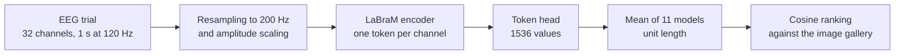

# EEG-to-image retrieval with an ensemble of fine-tuned LaBraM encoders

This repository holds the code of a solution to Track 1 (EEG-to-Image) of the
[EEG/EMG Foundation Challenge 2026](https://neural-interfaces26.github.io/).
One EEG trial recorded while a person looks at an image is mapped to the embedding space of DINOv2-giant, and the viewed image is found by ranking a gallery of candidate images.

The final score of the submission on the sealed test set is **0.001125** (top-5 retrieval accuracy, new people and new images).



## Task

| Item | Description |
|---|---|
| Input | one EEG trial, 32 channels of a consumer headset, 120 samples at 120 Hz (from 0.2 s before to 0.8 s after image onset) |
| Output | a vector of 1536 values in the feature space of DINOv2-giant |
| Score | for each person and each image, the predictions of all presentations are averaged, then compared by cosine similarity with the gallery; a query is correct when the viewed image is among the five most similar candidates |
| Sealed test set | people and images that are absent from all public data |

The public data of the same headset is Alljoined-1.6M (20 people, 16,540 training images and 200 test images).
The sealed gallery is much larger than the public one. Its size is not published; the granularity of the leaderboard scores points to several tens of thousands of candidate images, so the chance level is close to 0.0001.

## Method

The details and the equations are in [docs/method.md](docs/method.md). In short:

1. **Network.** The pretrained LaBraM encoder reads the trial as 32 tokens, one per electrode. A small head reduces each token, joins them and gives the 1536 output values. All weights are trained (9.0 million).
2. **Loss.** A contrast between the trials and the images of the batch, plus a cosine term that pulls the output towards the image target after the mean target has been removed.
3. **Person transport.** The spatial covariance of a trial is moved towards the covariance of another training person by an optimal transport map, which imitates recordings of more people. A shift of one or two samples in time is applied together with it.
4. **Same-image blending.** A trial is blended with another trial of the same image, from any training person.
5. **Start from THINGS-EEG2.** The network is first trained on THINGS-EEG2 (10 other people, research cap, same images), restricted to the 32 electrodes of the headset, and then on Alljoined-1.6M.
6. **Ensemble.** The unit outputs of eleven models are averaged.

The eleven models of the submission (`configs/ensemble.json`):

| Models | Start | Cosine term | Person transport and time shift | Same-image blending |
|---|---|---|---|---|
| `blend_things_run1`, `blend_things_run2` | THINGS-EEG2 model | centered | yes | yes |
| `blend_run1`, `blend_run2` | pretrained LaBraM | centered | yes | yes |
| `transport_things_run1`, `transport_things_run2` | THINGS-EEG2 model | centered | yes | no |
| `transport_run1`, `transport_run2` | pretrained LaBraM | centered | yes | no |
| `contrast_run1` | pretrained LaBraM | none | no | no |
| `centered_things_run1`, `centered_things_run2` | THINGS-EEG2 model | centered | no | no |

Every model is trained on all 20 people of Alljoined-1.6M for the submission.

## Results

**Sealed test set.** 0.001125, the score that counts for the final ranking.

**Held-out people of the public data.** The 20 people are split into 5 folds of 4. Each model is trained on 16 people and scored on the 4 others, on the 200 test images, which are never used for training. The values below are means over the 20 people.

| Model | top-5 of 200, one presentation | two presentations | all presentations | top-50 of 16,740, one presentation |
|---|---|---|---|---|
| `contrast_run1` | 0.07471 | 0.09809 | 0.23025 | 0.00875 |
| `centered_run1` (reference, not in the ensemble) | 0.07565 | 0.09785 | 0.24475 | 0.00857 |
| `transport_run1` | 0.07835 | 0.10378 | 0.24725 | 0.00876 |
| `blend_run1` | 0.08018 | 0.10641 | 0.26575 | 0.00920 |
| `centered_things_run1` | 0.07025 | 0.09278 | 0.22575 | 0.00872 |
| `transport_things_run1` | 0.07875 | 0.10481 | 0.23875 | 0.01029 |
| `blend_things_run1` | 0.08319 | 0.11060 | 0.26075 | 0.01040 |
| ensemble of seven fold models | 0.08621 | 0.11548 | 0.26150 | 0.01102 |

Chance is 0.025 for the first three columns and 0.0030 for the last one. The last column ranks the same queries against all 16,740 public images, which is closer to the sealed setting. The last row stands in for the submitted file on held-out people: one fold model for each of the six recipes of the submission, and a second one for `centered_things`.

These values were measured during the competition, before the code was reorganized into this repository.


## Setup

```bash
git clone <this repository>
cd eeg-image-retrieval
pip install -r requirements.txt
```

All commands are run from the root of the repository. The pretrained LaBraM weights (`braindecode/labram-pretrained` on Hugging Face) are downloaded by braindecode at the first use.

A quick check of the installation, on CPU, with simulated data and without any download:

```bash
python tests/test_end_to_end.py
```

## Data

The arrays are built with the loader of the organizers, so that the trials have the same preprocessing as on the scoring machine. The same loader computes the image targets with DINOv2-giant. This step needs its own environment (Python 3.12 or later):

```bash
git clone --depth 1 https://github.com/neural-interfaces26/2026-competition.git
pip install -r 2026-competition/requirements.txt transformers pyunpack

export ALLJOINED_ACCEPT_LICENCE=1
python tools/export_dataset.py --study alljoined-1.6m --competition-repo 2026-competition \
    --data-dir work --out data/alljoined --download

export NEURALFETCH_THINGS_PASSWORD=<password of the THINGS image database>
python tools/export_dataset.py --study things-eeg2 --competition-repo 2026-competition \
    --data-dir work --out data/things_eeg2 --download
```

`ALLJOINED_ACCEPT_LICENCE=1` states that the license of Alljoined-1.6M (non-commercial) is accepted. The password of the THINGS images is given after its license is accepted, see the documentation of NeuralBench.

Each export folder holds:

| File | Content |
|---|---|
| `train_X.npy`, `val_X.npy`, `test_X.npy` | trials, channels by samples, half precision |
| `*_subject.npy`, `*_image.npy` | person and image index of every trial |
| `targets_dinov2_giant.npy` | one target vector per image index |
| `meta.json` | channel names and sampling rate |

For Alljoined-1.6M the export used in this project has 1,335,775 trials of the 16,540 training images and 324,295 trials of the 200 test images (about 13 GB). Training loads all trials into memory, so about 16 GB of memory are needed for this dataset.

## Training

```bash
# stage one: THINGS-EEG2, on the 32 electrodes and the window of the headset
python -m eeg_retrieval.train --config configs/things_eeg2.json --data data/things_eeg2 \
    --channels-from data/alljoined --out checkpoints

# the eleven models of the submission, each on all 20 people
python -m eeg_retrieval.train --config configs/ensemble.json --data data/alljoined --out checkpoints
```

Every visible GPU runs one model at a time. The competition models were trained on two T4 GPUs: one model takes about 50 minutes on one T4 (12 epochs of 400,000 trials), so the eleven models need about 4.5 hours on the two. Models whose files are already in the output folder are skipped, so an interrupted session can be continued. `--hours 11` avoids starting a model that could not finish inside a session of 12 hours, and `--only name1 name2` selects models.

## Scores on held-out people

```bash
python -m eeg_retrieval.train --config configs/ensemble.json --data data/alljoined --out checkpoints --mode folds
python -m eeg_retrieval.train --config configs/baseline.json --data data/alljoined --out checkpoints --mode folds

python -m eeg_retrieval.evaluate --data data/alljoined --predictions checkpoints/folds \
    --models contrast_run1 centered_run1 transport_run1 blend_run1 \
             centered_things_run1 transport_things_run1 blend_things_run1 \
    --ensemble contrast_run1 transport_run1 blend_run1 \
               centered_things_run1 centered_things_run2 transport_things_run1 blend_things_run1
```

`--mode folds` trains the five folds of every model that has `"folds": true` in its configuration and saves the predictions for the held-out people. These are 40 runs of about 50 minutes each on one T4. `evaluate` prints the table of the Results section, one row for each model and one for the ensemble.

## Submission file

```bash
python -m eeg_retrieval.package --config configs/ensemble.json --checkpoints checkpoints \
    --data data/alljoined --out submission
```

This writes `submission/` and `submission.zip`:

| File | Content |
|---|---|
| `submission.py` | one self-contained file with the network, the ensemble and the `Solver` class of the competition |
| `model.json` | list of models, encoder configuration, channels, window, sampling rate |
| `weights/*.pt` | weights in half precision |
| `reference.npz` | eight trials with the outputs of every model, for the self-test |

At loading time the file selects its 32 channels by name, checks the sampling rate, the window and the size of the target, and compares its outputs on the eight stored trials with the stored outputs. It raises an error instead of predicting when one of these checks fails.

The command also runs the checks of `eeg_retrieval.check`: the same output on a second call, with a shuffled montage, with a longer window and in another trial order, and the scores on the public test trials in shuffled batches of 64. An existing file is checked with:

```bash
python -m eeg_retrieval.check --submission submission.zip --data data/alljoined
```

For the submitted file (11 models, 183 MB) this check gave a top-5 of 0.4418 on the 200 public test images with all presentations (the 20 people are seen in training here) and 4.1 minutes for 100,000 trials on one T4.

## Reproducibility

- The sealed test set is private. The score of 0.001125 can only be measured by the competition platform.
- Training on GPU uses half precision and kernels that are not deterministic. Two runs of one configuration give two slightly different models: in the experiments a second seed moved the single-trial top-5 by less than 0.001. A file built with this repository is equivalent to the submitted one, not identical.
- The two `centered_things` models of the submitted file are two separate training runs of this recipe.
- This repository is a reorganized version of the code used during the competition. It was compared with the original code on small local data, on CPU. With the same seeds, the training code gives the same weights bit for bit, for the five loss and augmentation variants. The evaluation command gives the same scores, and a file built by the original code passes the self-test of the public inference code. The full training on GPU was not repeated from this version.
- The stage on THINGS-EEG2 and the export tool are written for release 0.4.0 of the organizers' libraries. The arrays and the stage-one checkpoint behind the submitted models were produced earlier in the project, with an earlier release of these libraries.

## Pretrained models, datasets and licenses

This repository contains code only. Each external resource keeps its own license, which has to be read before use:

- LaBraM weights in the braindecode format: `braindecode/labram-pretrained` on Hugging Face (BSD 3-Clause).
- Alljoined-1.6M: NEMAR dataset `nm000134` (CC BY-NC-ND 4.0).
- THINGS-EEG2 (CC BY 4.0) and the THINGS image database (own license).
- DINOv2-giant: `facebook/dinov2-giant`, used only by the organizers' loader to compute the image targets.
- Loader and scoring code of the organizers: `neural-interfaces26/2026-competition`, built on NeuralBench.

## References

- W.-B. Jiang, L.-M. Zhao, B.-L. Lu. Large Brain Model for Learning Generic Representations with Tremendous EEG Data in BCI. ICLR 2024.
- J. Xu et al. Alljoined-1.6M: A Million-Trial EEG-Image Dataset for Evaluating Affordable Brain-Computer Interfaces. arXiv:2508.18571, 2025.
- A. T. Gifford, K. Dwivedi, G. Roig, R. M. Cichy. A large and rich EEG dataset for modeling human visual object recognition. NeuroImage 264:119754, 2022.
- M. Oquab et al. DINOv2: Learning Robust Visual Features without Supervision. Transactions on Machine Learning Research, 2024.
- NeuralBench: A Unifying Framework to Benchmark NeuroAI Models. arXiv:2605.08495, 2026.
